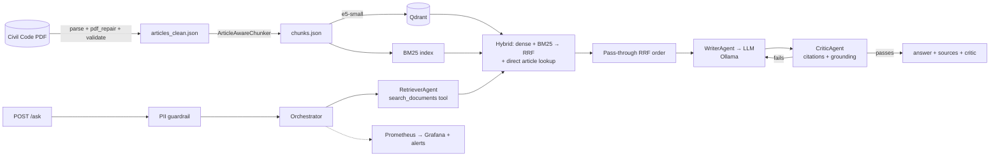

# Egyptian Civil Code RAG — مساعد قانوني بالاستشهاد بالمواد

نظام RAG يجيب عن أسئلة بالعربية (والإنجليزية) من **القانون المدني المصري** ويذكر **رقم المادة** مع كل إجابة.
مشروع نهائي — The MLOps Practitioner، Project 2 (LLM/RAG).



> هيكل المشروع الكامل: `docs/project-structure.md`

## مراحل الـ RAG (بترتيب التنفيذ)

| # | المرحلة | الملفات (تحت `src/rag/`) | الدور |
|---|---|---|---|
| 1 | Ingestion | `ingestion/{parser,pdf_repair,source_corrections,normalizer,validator}.py` | PDF → مواد منظمة (`is_repealed`, `text_en`) وإصلاح عيوب الاستخراج |
| 2 | Chunking | `chunking/chunker.py` | chunk لكل مادة (يقسّم الطويلة) مع عنوان الباب |
| 3 | Embedding | `embedding/embedder.py` | e5-small محليًا (بادئات `query:`/`passage:`) |
| 4 | Indexing | `indexing/{vector_store,manifest,factory}.py` | Qdrant + manifest يربط الفهرس بالداتا والموديل |
| 5 | Query processing | `query_processing/query_analysis.py` (+ `ingestion/legal_arabic_text.py`) | تطبيع، لهجة مصرية، tokens للـ BM25، استخراج «المادة N» |
| 6 | Retrieval | `retrieval/{sparse,dense,hybrid}.py` | BM25 + dense، وتثبيت المادة المطلوبة صراحةً |
| 7 | Fusion | `fusion/rrf.py` | Reciprocal Rank Fusion |
| 8 | Reranking | `reranking/reranker.py` | الترتيب المدمج RRF دون خدمة خارجية |
| 9 | Context building | `context_building/builder.py` | كتلة الأدلة الموسومة (مادة / ملغاة / مستند القضية) |
| 10 | Generation | `generation/{prompts,llm_client}.py` | Ollama عبر واجهة OpenAI-compatible |
| 11 | Validation | `validation/critic.py` | استشهادات + grounding + رفض أمين (حتمي بدون LLM) |

خارج `rag/`: `agents/{orchestrator,retriever,writer}.py` (retrieve → write → critic → إعادة كتابة)، `tools/{search_documents,tavily_search}.py`، `core/` (الإعدادات، الحماية، الكاش)، `api/main.py` + `Frontend/index.html` (الخدمة والواجهة)، و`rag/evaluation` و`rag/monitoring` (RAGAS/drift، Prometheus).
MLOps: `dvc.yaml`، MLflow محلي، Prometheus/Grafana (`monitoring/`)، Locust، GitHub Actions، Docker.

## التشغيل

### B) Docker (اختياري): API + Qdrant + Prometheus/Grafana، وOllama مثبّت على جهازك
ثبّت تطبيق Ollama على Windows وشغّله، ثم:
```bash
ollama pull qwen2.5:3b      # مرة واحدة، على جهازك
cp .env.example .env        # الوضع المحلي مفعّل افتراضيًا
docker compose up -d --build
# الواجهة http://localhost:8000 · Grafana :3000 · Prometheus :9090 · Qdrant :6333
```
الحاويات تصل إلى Ollama عبر `http://host.docker.internal:11434/v1`. لو ظهر «LLM server reachable: FAIL» فاضبط على Windows متغير البيئة `OLLAMA_HOST=0.0.0.0` وأعد تشغيل Ollama (لم يُجرَّب هنا). خدمتا التهيئة `init-models` و`indexer` تعمل مرة وتنتهي، ثم يبدأ الـ API. صورة الـ API تُسحب من Docker Hub (`DOCKERHUB_USERNAME` في `.env`) إن وُجدت وإلا تُبنى محليًا.

### A) بدون Docker (الأبسط)
```powershell
python -m venv .venv ; .venv\Scripts\activate
pip install -e ".[dev]"
copy .env.example .env
ollama pull qwen2.5:3b
python scripts/data/download_models.py ; python scripts/data/build_index.py --input data/serving/chunks.json
python scripts/ops/check_local_stack.py ; uvicorn api.main:app --app-dir src --port 8000
```
Prometheus وGrafana بدون Docker: `monitoring/local/README.md`.

### إعادة بناء البيانات من الـ PDF
```bash
# ضع الملف في data/raw/civil_code.pdf
dvc repro && python scripts/data/export_serving_data.py   # يحدّث data/serving/chunks.json (يُرفع على git ويدخل صورة Docker)
```

## حجم التشغيل والمساحة
الكود ≈6MB؛ المساحة من الـ image والنماذج (تقريبية): نموذج Ollama ≈1.9GB، e5-small ≈0.5GB، torch CPU وباقي المكتبات عدة مئات MB. DVC وRAGAS وMLflow وPrometheus وGrafana ضمن الأساس. التنظيف: `docker system prune`، و`docker compose down -v` يحذف الـ volumes.

## API
`POST /ask` ← `{"question": "..."}`
```json
{
  "answer": "...وفقا للمادة 163...",
  "sources": [{"article_number": 163, "citation": "Egyptian Civil Code, Article 163"}],
  "case_sources": [],
  "critic": {"passed": true, "grounding": 0.91, "issues": [], "revisions": 0, "refusal": false},
  "pii_redacted": [], "used_web_search": false
}
```
`POST /ask/stream` (نفس خط الـ RAG الكامل بما فيه المراجِع، ثم بث الإجابة المُتحقَّق منها: `event: status` ← `data:` كلمات ← `event: result` بـ JSON كامل).
باقي النقاط: `GET /health` · `GET /ready` (يتحقق من Ollama والموديل، وتطابق الفهرس مع الداتا والـ embedding) · `GET /stats` · `GET /article/{n}` (مع `text_missing`/`text_incomplete`) · `GET /search?q=` · `POST /feedback` · `GET /metrics` · `GET /cache/stats`.
**سلوك الأمان:** إجابة لم تنجح مراجعتها تُرجَع بتنبيه ظاهر (`critic.passed=false`) ولا تُخزَّن في الكاش؛ وإن استشهدت بمادة غير موجودة في الأدلة تُستبدل بنصوص المواد المسترجعة حرفيًا؛ والمادة التي نصها غير متوفر في المصدر لا يُجاب عنها، والناقصة (1022) تُلحق بتنبيه.

**ملفات القضية:** `POST /cases` ← `POST /cases/{id}/documents` (PDF بطبقة نصية أو Word أو TXT/Markdown) ← `/ask` بحقل اختياري `case_id` (يرجع `case_sources` بمقاطع الملفات المستخدمة) · `GET /cases/{id}` · `DELETE /cases/{id}[/documents/{doc}]` · `GET /cases/capabilities`. ملفات الصور وPDF الممسوح ضوئيًا دون طبقة نصية غير مدعومة.
إن نقصت الإعدادات يردّ `/ask` بـ **503** برسالة واضحة بدل الانهيار.

## قرارات التصميم (ولماذا)
* **FastAPI فقط** (بدون BentoML/vLLM/AWQ): لا يوجد GPU مناسب؛ التوليد عبر Ollama المحلي. **انحراف عن بنود الـ handbook** يُذكر في التسليم.
* **لا نحذف المواد الملغاة**: `is_repealed=true` وتبقى قابلة للاسترجاع مع وسم «ملغاة» في الـ prompt.
* **المادة المذكورة صراحةً تُثبَّت أولًا** حتى لو رتّبها الـ reranker أدنى (`HybridRetriever.pin`).
* **Critic حتمي بدون LLM**: يتحقق أن كل رقم مادة مستشهد به موجود في السياق، وأن الإجابة مستندة لغويًا للنصوص؛ فشله يعيد الكتابة مرة (`AGENT_MAX_REVISIONS`)، وبعدها يظهر التنبيه أو يُستخدم النص الحرفي (انظر «سلوك الأمان»). الرفض الأمين يُقبل فقط إن كان قصيرًا.
* **PII**: الهاتف/الرقم القومي/الإيميل/البطاقة تُحجب قبل الـ LLM والـ cache والـ tracing.
* **عيوب الـ PDF** (مكتشفة بالفحص): رابط «لا» يُستخرج «ال» والأرقام متعددة الخانات معكوسة — أُصلحت في `pdf_repair.py`.
* **Parser v2**: التقطيع بسلسلة علامات «مادة N» العربية بدل عنوان «Article N» الإنجليزي. النسخة الأولى كانت تُسند نص ~6% من المواد (65) لمادة خاطئة أو مبتورة، وتُسقط 6 مواد؛ الآن 1149/1149 (56 ملغاة). المادة 1022: الفقرة (1) بالعربية غير موجودة في الـ PDF، والفقرتان (2)–(3) نُقلتا من كتلة 1021 (موثّق في `data/interim/source_corrections_applied.json` ويحتاج تأكيد محامٍ). انظر `docs/data-quality.md` و`reports/retrieval_bm25_eval.md`.

## وثائق تفصيلية
`docs/runbook.md` · `docs/project-structure.md` · `docs/architecture.md` · `docs/data-quality.md` · `docs/evaluation.md` · `docs/deployment.md` · `docs/operations.md`
الوضع الافتراضي محلي بالكامل (`PROVIDER_PROFILE=local`, `LOCAL_ONLY=true`). النموذج اللغوي وembeddings وQdrant يعملون محليًا، ويُستخدم ترتيب RRF دون reranker أو بحث ويب خارجي. يُعطّل Langfuse في هذا الوضع حتى عند وجود مفاتيحه؛ سجلات التشغيل محلية.

## الجودة والمراقبة
* اختبارات: `pytest` (180 اختبار، تغطية ≈88%، بوابة 70%)، `ruff`، `mypy --strict` (في بيئة التطوير هنا يظهر ~35 خطأ نوع ناتجة غالبًا عن pydantic/FastAPI ولم يُتأكد من زوالها على جهازك، وخطوة `mypy src` في CI قد تفشل بسببها)، وبوابة جودة استرجاع offline (`hit@5 ≥ 0.80`) في CI، موزّعة على workflowين مستقلين: `ci.yml` و`docker.yml`.
* MLflow: `scripts/evaluation/mlflow_chunking_experiments.py` (5 تشغيلات على chunk size/overlap؛ `mlflow.bat` يولّدها تلقائياً أول مرة) — `mlflow ui --backend-store-uri sqlite:///mlflow.db`.
* RAGAS + مقاييس مباشرة (`citation_hit`, `critic_pass_rate`): `python scripts/evaluation/run_evaluation.py --dataset data/eval/golden_set.json --ragas`.
* Prometheus/Grafana: `monitoring/prometheus.yml` + `alerts.yml` (faithfulness < 0.80، drift MMD > 0.15، فشل الـ critic، p95) و`monitoring/grafana/dashboards/civil_code_rag.json`.
* Drift: MMD + cosine مقابل baseline، **وفرق عن آخر تشغيل ومتوسط آخر 7 تشغيلات** (`scripts/evaluation/monitor_drift.py`، تنبيه `EmbeddingDriftMoving`).
* Load test: `scripts/loadtest/locustfile.py` — نُفّذ مع stub للـ LLM فقط (`reports/loadtest_stub.md`، ليست زمن الإنتاج)؛ شغّله على النظام الحقيقي لأرقام فعلية.

## ما تحقق فعليًا وما لم يُشغَّل بعد
| تم تشغيله وقياسه هنا | مكتوب ومُختبَر بالـ mocks فقط (لم يُشغَّل بخدمة حقيقية) |
|---|---|
| parser v2/validator/chunker على الـ PDF الحقيقي (1149 مادة، 56 ملغاة، 1065 بعنوان فصل) | Ollama الحقيقي، Langfuse |
| retrieval BM25 على golden set (انظر التقرير) | e5-small (محلي) وreranker وتقطير الـ reranker، وصفوف Dense/Hybrid/Reranker في الـ benchmark (محجوبة) |
| Qdrant embedded + e2e للـ API بمحرك embedding مزيّف | RAGAS على إجابات LLM حقيقية |
| اختبارات cache/drift/الأمان، Locust مع stub (`reports/loadtest_stub.md`)، benchmark الـ BM25 | Docker/compose |

**حدود معروفة**: golden set كتبه المساعد ولم يراجعه قانوني؛ بقايا نادرة من عيوب الـ PDF في النص المعروض (مثل حرف «ا» زائد في آخر فقرة المادة 1)، وكلمات «لا/ال» الملتبسة في وسط الكلمة تُعالَج في BM25 بطيّ `لا≡ال`؛ المادة 1022 ناقصة في المصدر (الفقرة (1) بالعربية) وتحتاج نسخة رسمية وتأكيد محامٍ على نقل الفقرتين (2)–(3) من 1021؛ صحة نصوص المواد قانونيًا لم تُراجَع بشريًا. إجابات النظام **ليست استشارة قانونية**.

## ملفات القضية
اختياري (`CASE_UPLOAD_ENABLED=true` افتراضيًا؛ `false` يعطّله). تُستخرج النصوص من PDF ذي طبقة نصية وWord وTXT/Markdown، وتُفهرس في فهرس BM25 منفصل لكل قضية. لا تدخل في فهرس القانون؛ والأسطر التي تشبه تعليمات للنموذج تُحذف قبل الفهرسة. حدود الرفع: `CASE_MAX_FILE_MB=10`، `CASE_MAX_DOCS=10`.

## الواجهة
بعد تشغيل `uvicorn` افتح **http://localhost:8000/** (نفس الأصل، بلا CORS). للتجربة بدون خادم: افتح `Frontend/index.html?mock=1`.
صفحات الواجهة: **المحادثة** (بث الإجابة المُتحقَّق منها + نسخ)، **السجل**، **المتابعة** (لوحة مؤشرات حية من `/stats`)، **القضية** (رفع PDF نصي/Word/نص)، **المراجع** (بحث برقم المادة).
نقاط النهاية التي تستخدمها: `/ask/stream`, `/ready`, `/stats`, `/article/{n}`, `/search?q=`, `POST /feedback` (نص المادة الكامل لشارات المراجع). لواجهة مستضافة على أصل آخر اضبط `CORS_ORIGINS` و`?api=http://host:8000`.


## تشغيل سريع على Windows
`scripts\windows\setup.bat` ثم `scripts\windows\start.bat` — التفاصيل في [docs/runbook.md](docs/runbook.md).
