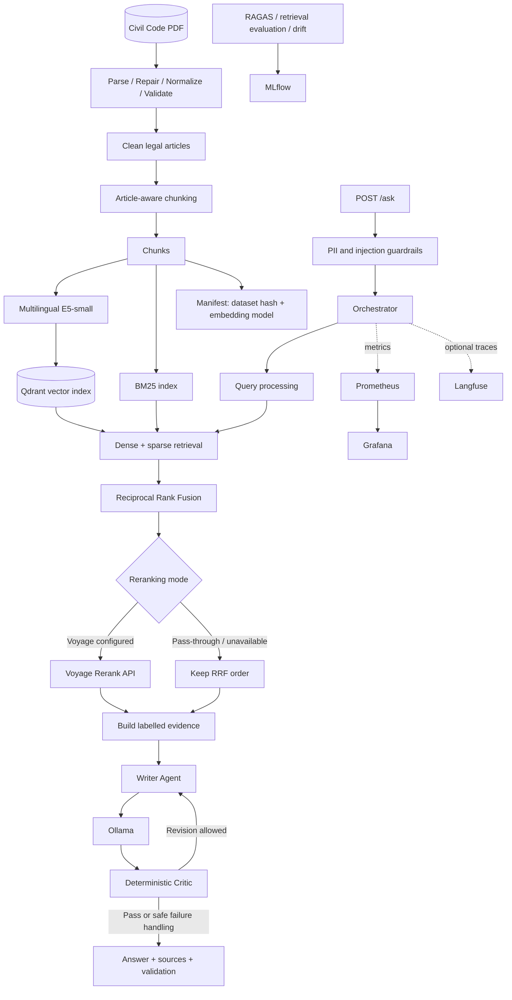

# Egyptian Civil Code RAG

A locally deployable Retrieval-Augmented Generation (RAG) system for searching and understanding the Egyptian Civil Code. The pipeline combines article-aware document processing, hybrid retrieval, evidence-grounded generation, and deterministic answer validation.

> **Legal disclaimer:** This project supports legal research and information retrieval. Generated answers are informational and must be checked against authoritative legal sources. The system is not a substitute for advice from a qualified legal professional.

## Table of Contents

- [Overview](#overview)
- [Key Features](#key-features)
- [Architecture](#architecture)
- [End-to-End Pipeline](#end-to-end-pipeline)
- [Quick Start](#quick-start)
- [Configuration](#configuration)
- [Evaluation](#evaluation)
- [Security and Privacy](#security-and-privacy)
- [Troubleshooting](#troubleshooting)
- [Known Limitations](#known-limitations)
- [Contributing](#contributing)
- [License](#license)

## Overview

Legal_RAG is organized as a modular pipeline. Offline ingestion and indexing prepare the legal corpus; the API then processes questions, retrieves relevant evidence, generates an answer through Ollama, and validates the result before returning it.

### Key Features

- **Legal-aware ingestion:** PDF parsing, extraction repair, source corrections, normalization, and validation.
- **Article-aware chunking:** Preserve article boundaries, chapter titles, and metadata; split long articles when needed.
- **Local embeddings:** Multilingual E5-small embeddings with the appropriate `query:` and `passage:` prefixes.
- **Hybrid retrieval:** BM25 keyword retrieval combined with dense semantic retrieval through Qdrant.
- **Article-aware search:** Detect explicit article references and prioritize the requested articles.
- **Rank fusion:** Reciprocal Rank Fusion (RRF) combines sparse and dense result rankings.
- **Optional reranking:** A Voyage Rerank API path may be configured; pass-through mode preserves the RRF order and does not independently rerank documents.
- **Evidence-grounded generation:** Ollama generates answers from labelled retrieved evidence.
- **Deterministic validation:** The Critic checks citation and grounding conditions without an additional LLM call.
- **Privacy guardrails:** The documented guardrail masks common PII patterns and refuses detected prompt-injection questions.
- **Observability and evaluation:** Prometheus/Grafana monitoring, optional Langfuse tracing, RAGAS evaluation, and drift-related tooling.

## Architecture



### Main Components

Package paths below are relative to `src/`.

| Stage | Components | Responsibility |
|---|---|---|
| Ingestion | `rag/ingestion/` | Parse PDFs, repair extraction errors, apply source corrections, normalize text, and validate legal article records. |
| Chunking | `rag/chunking/chunker.py` | Create article-aware chunks and preserve article/chapter metadata. |
| Embedding | `rag/embedding/embedder.py` | Generate local multilingual E5-small embeddings using query and passage prefixes. |
| Indexing | `rag/indexing/` | Store vectors in Qdrant and maintain a manifest tying the index to the dataset and embedding model. |
| Query processing | `rag/query_processing/query_analysis.py` | Normalize the question, prepare legal Arabic BM25 tokens and embedding text, and detect explicit article references. |
| Retrieval | `rag/retrieval/` | Run sparse BM25 and dense vector retrieval; combine results and handle explicit article pinning. |
| Fusion | `rag/fusion/rrf.py` | Merge result rankings with Reciprocal Rank Fusion. |
| Reranking | `rag/reranking/reranker.py` | Use Voyage Rerank when configured and available; otherwise pass through the existing ranking. |
| Context building | `rag/context_building/builder.py` | Build labelled evidence from articles, repeal metadata, case-document excerpts, and permitted web results. |
| Generation | `rag/generation/` | Generate an answer through Ollama's OpenAI-compatible interface. |
| Validation | `rag/validation/critic.py` | Apply deterministic checks for citations, lexical grounding, and refusal behavior. |
| Agents and API | `agents/`, `api/` | Orchestrate retrieval and generation and expose the FastAPI endpoints. |
| Evaluation and monitoring | `rag/evaluation/`, `rag/monitoring/`, `monitoring/` | Provide evaluation/drift tools, metrics, tracing, dashboards, and alerts. |

## End-to-End Pipeline

1. **Prepare the corpus.** Parse the Civil Code PDF, repair extraction issues, apply documented source corrections, normalize the text, and validate article records.
2. **Build chunks and indexes.** Split content along legal article boundaries where possible, generate embeddings, populate Qdrant and BM25, and maintain the index manifest.
3. **Process the question.** Apply privacy and injection guardrails, then normalize the query and identify explicit article references.
4. **Retrieve evidence.** Run sparse and dense retrieval, fuse rankings with RRF, and prioritize explicitly requested articles according to the retrieval implementation.
5. **Build context.** Assemble evidence with labels and metadata. Case-document excerpts are treated as factual context rather than Civil Code article citations. Optional web results must remain clearly distinguished from Civil Code sources.
6. **Generate an answer.** The Writer Agent uses the retrieved evidence to generate an answer through Ollama.
7. **Validate the answer.** The deterministic Critic checks citation and grounding rules. The documented flow allows a bounded revision attempt controlled by `AGENT_MAX_REVISIONS`. If validation still fails, the application uses its configured fail-safe behavior; unverified answers should be clearly marked and not cached.
8. **Monitor and evaluate.** Prometheus and Grafana support operational monitoring; optional Langfuse tracing and the evaluation tooling support debugging, retrieval experiments, and quality assessment.

## Quick Start

> **Important:** Verify the commands and required services against the current configuration before running them. Model names, environment variables, and data paths may vary by deployment profile.

### 1. Prerequisites

- Python version supported by `pyproject.toml`.
- Git.
- Ollama for local answer generation.
- Required model files downloaded and available to the configured runtime.
- Qdrant and any other services enabled by the chosen configuration.
- Optional Docker and Docker Compose for containerized deployment.

### 2. Get the code and install dependencies

```bash
git clone https://github.com/alinasr2pp0/Legal_RAG.git
cd Legal_RAG
python -m venv .venv
```

Activate the environment:

```powershell
# Windows PowerShell
.\.venv\Scripts\Activate.ps1
```

```bash
# Linux / macOS
source .venv/bin/activate
```

Install the project using the repository's supported packaging configuration:

```bash
python -m pip install --upgrade pip
pip install -e .
```

If the editable install is not used, the project structure documents this alternative API command:

```bash
uvicorn api.main:app --app-dir src --port 8000
```

### 3. Configure the environment

Review `.env.example`, `config/providers.yaml`, `params.yaml`, and the deployment documentation. Create a local `.env` only with the settings required for your chosen profile. Do not commit `.env` or real credentials.

Check the configured values for at least:

- Generation provider and Ollama model.
- Embedding model and local model paths.
- Qdrant endpoint and collection.
- Reranker configuration.
- `LOCAL_ONLY` and optional web/tracing settings.
- `AGENT_MAX_REVISIONS` and request timeouts, where supported.

The repository documents `LOCAL_ONLY=true` as the mode that prevents external service use, with Langfuse described as an opt-in exception. Confirm the actual behavior in the current configuration before relying on this setting for a sensitive deployment.

### 4. Prepare the corpus and indexes

The repository contains data-processing scripts under `scripts/data/`, including PDF parsing, validation/normalization, chunking, index building, serving-data export, and model downloads.

Run the stages in the order documented by the project and its `dvc.yaml` pipeline. Before rebuilding, inspect the current data and index manifest so you do not overwrite or unnecessarily regenerate existing artifacts.

Typical logical sequence:

1. Parse and repair the source PDF.
2. Validate and normalize the article records.
3. Generate article-aware chunks.
4. Generate embeddings and build the index.
5. Verify the index manifest against the dataset and embedding model.

Use the exact script names, flags, and input/output paths present in the checked-out version; this README intentionally does not invent command-line arguments that have not been verified.

### 5. Start required services and the API

Start Ollama, Qdrant, and any other services required by your selected configuration. Docker Compose configuration is available in the repository; inspect the service definitions and environment settings before starting the stack.

The project structure documents this API command when dependencies and services are ready:

```bash
uvicorn api.main:app --app-dir src --port 8000
```

If the package has been installed in editable mode and the import path is configured accordingly, the documented alternative is:

```bash
uvicorn api.main:app --port 8000
```

### 6. Check readiness and ask a question

Open the API root in a browser to access the frontend served by the API, if enabled. Check the readiness endpoint:

```bash
curl http://localhost:8000/ready
```

Example request shape for the documented `POST /ask` endpoint (confirm the exact request schema in the API implementation or its OpenAPI documentation):

```bash
curl -X POST http://localhost:8000/ask \
  -H "Content-Type: application/json" \
  -d '{"question":"ما شروط التعويض عن عدم تنفيذ الالتزام؟"}'
```

A successful response should follow the actual API response schema and may include the generated answer, cited sources, and Critic validation results. The exact JSON fields and expected answer depend on the checked-out version, corpus, and runtime configuration.

For the authoritative request/response schema, open the API's OpenAPI page, typically `http://localhost:8000/docs`, while the local API is running.

## Configuration

Review these repository configuration points before changing behavior:

- `.env.example` — environment variable template.
- `config/providers.yaml` — provider/backend profiles.
- `params.yaml` — chunking and retrieval parameters.
- `dvc.yaml` — offline data and indexing pipeline.
- `docker-compose.yml` — service topology and port bindings.
- `monitoring/` — Prometheus configuration, alert rules, and Grafana provisioning.

### Retrieval and reranking behavior

The default documented retrieval design combines dense semantic search and BM25, then applies RRF. Explicitly requested article references may be pinned to the top of the result list.

The reranking stage has two documented behaviors:

- **Voyage Rerank:** an external reranking API when configured and available.
- **Pass-through:** preserves the existing RRF ranking without calculating independent relevance scores.

Pass-through is not model-based reranking. Evaluate a real reranker against the same held-out legal questions before deciding whether its quality gains justify added latency, resource use, and external-service dependencies.

### Critic and retry behavior

The Critic is documented as deterministic and does not make an additional LLM call. It checks citation validity, missing or unsupported citations, and lexical grounding. The writer revision loop must remain bounded by `AGENT_MAX_REVISIONS` (or the corresponding configured limit). Confirm the actual retry semantics and fail-safe response in code and tests.

## Evaluation

The repository includes evaluation and experiment tooling under `scripts/evaluation/`, `src/rag/evaluation/`, and `data/eval/`. Use the existing golden set and scripts where applicable, and record the dataset/model/configuration versions alongside results.

For a legal RAG system, evaluate both retrieval and answer quality:

| Area | Suggested measure | What it tells you |
|---|---|---|
| Retrieval | Recall@k | Whether the expected article appears among the top-k results. |
| Retrieval | MRR | How highly the first relevant result is ranked. |
| Retrieval | nDCG@k | Whether the ranking places more relevant evidence ahead of less relevant evidence. |
| Citations | Citation accuracy | Whether cited article references actually support the associated claims. |
| Grounding | Faithfulness / claim support | Whether answer claims are supported by retrieved evidence. |
| Answer quality | Expert-reviewed correctness | Whether the legal interpretation matches an authoritative reference. |
| Refusal | Abstention precision and recall | Whether the system abstains when evidence is insufficient without over-refusing answerable questions. |
| Operations | Latency, error rate, resource use | Whether quality is delivered within operational limits. |

Create or maintain a legal-question evaluation set with verified answers and article references. Include current provisions, repealed or amended provisions where the source data supports them, explicit article-number questions, ambiguous questions, and questions for which the corpus does not contain sufficient evidence. Have qualified reviewers verify the reference labels.

Do not treat retrieval metrics or automated LLM-based scores alone as proof of legal correctness.

## Security and Privacy

Before exposing the application beyond a trusted local environment:

- Review all published ports and bind administrative services to trusted interfaces.
- Secure Grafana, Prometheus, Qdrant, and API endpoints with appropriate authentication and network controls for the deployment.
- Keep credentials and API keys out of source control; use deployment-appropriate secret management.
- Test PII masking and verify that sensitive values are not unintentionally written to logs, traces, caches, or error responses.
- Test prompt-injection handling in both user questions and retrieved documents. Treat retrieved text as untrusted data, not as instructions to the application.
- Keep external web search and telemetry disabled when the deployment requires strict local-only operation, and verify configuration behavior rather than relying on a variable name alone.
- Add tests for malformed inputs, oversized requests, timeouts, dependency failures, and repeated Critic rejection.
- Bound retry loops and use safe failure responses when validation cannot pass.
- Avoid logging complete legal case documents or sensitive user-provided content unless there is a documented, authorized need.

Security tests should validate actual runtime behavior; the presence of a guardrail module does not by itself establish that the application is secure.

## Troubleshooting

### API cannot start

- Confirm the virtual environment is active and dependencies are installed.
- Check the import path; the documented source layout uses `src/`.
- Inspect application logs for configuration or missing-module errors.

### Readiness check fails

- Confirm Ollama and Qdrant are running if required by the selected profile.
- Verify model availability and configured model names.
- Check the index manifest against the source dataset and embedding model.
- Confirm service URLs and ports match the active environment.

### No or weak retrieval results

- Confirm the expected articles exist in the validated corpus and index.
- Check article-number parsing and Arabic token normalization.
- Compare BM25, dense retrieval, and RRF results separately.
- Verify that the query and passage embedding prefixes are applied correctly.
- Run the existing retrieval evaluation scripts before changing ranking parameters.

### Answers fail Critic validation

- Inspect the retrieved evidence and the cited article identifiers.
- Check whether the context contains complete source text.
- Confirm that retry limits are bounded and that fail-safe responses are visible to the caller.
- Do not remove validation checks solely to make a response pass.

### External services are contacted unexpectedly

- Inspect provider profiles and environment variables.
- Verify `LOCAL_ONLY` behavior in code and tests.
- Check optional reranking, web fallback, and tracing settings separately.

## Known Limitations

- Pass-through reranking preserves the fused ranking and does not independently score or reorder documents.
- Retrieval and deterministic validation do not guarantee that every legal interpretation is correct.
- The legal status of an article can only be as reliable as the underlying source corpus and its amendment/repeal metadata.
- Optional external services can introduce network dependencies, latency, credentials, and data-handling considerations.
- API commands, request fields, environment variables, and service requirements should be checked against the current repository version; this guide does not claim that every deployment profile has been executed end to end.

## Contributing

Contributions are welcome. For changes to ingestion, chunking, retrieval, reranking, or validation, please include focused tests and, where relevant, before/after evaluation results. For legal-content changes, provide authoritative source references and preserve provenance.

## License

Check the repository's license file for the applicable terms.
