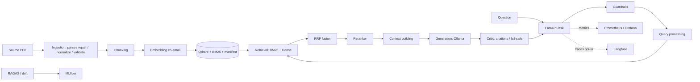

# Architecture

Request path of `POST /ask`. Package paths are under `src/`.

1. **Guardrail** – `core/guardrails.py` masks phone / national-ID / e-mail / card numbers and refuses
   prompt-injection questions without calling the LLM. The masked question is what the LLM, cache,
   query log and Langfuse see. Answers to questions with PII are not cached.
2. **Orchestrator** (`agents/orchestrator.py`) – owns the loop and returns a typed result.
3. **RetrieverAgent** (`agents/retriever.py`) → `tools/search_documents.py`, which runs the retrieval stages:
   * **Query processing** (`rag/query_processing/query_analysis.py`): BM25 tokens (legal Arabic tokenizer,
     lam-alef fold), the embedding text and explicit article numbers ("المادة 163", "المادتين 163 و164",
     "Article 163", small ranges).
   * **Retrieval** (`rag/retrieval/`): `sparse.py` (BM25) and `dense.py` (embedder + Qdrant), combined by
     `hybrid.py`.
   * **Fusion** (`rag/fusion/rrf.py`): Reciprocal Rank Fusion, k=60. Explicitly requested articles are
     **pinned first** and the reranker may not demote them.
   * **Reranking** (`rag/reranking/reranker.py`): Voyage Rerank API, or pass-through (`RERANKER_ENABLED=false` / unavailable).
   * Optional web fallback `tools/tavily_search.py` (needs your own key, `WEB_SEARCH_ENABLED=true`, not
     allowed under LOCAL_ONLY). Web results carry `source=web` and are never listed as Civil Code citations.
   * Case-document excerpts (`/ask` with `case_id`) are added as facts-only evidence; they carry no article
     number, so they can never become citations.
4. **Context building** (`rag/context_building/builder.py`) labels each chunk (article / repealed / case
   document / web) and builds the user prompt; **generation** (`rag/generation/`) sends it to Ollama through an
   OpenAI-compatible client. Only articles actually cited in the answer are returned as `sources`.
   Articles whose text is missing in the source are removed from the evidence (the answer says the text is
   unavailable); a cited article with incomplete text (1022) gets an explicit caveat.
5. **Validation** (`rag/validation/critic.py`) – deterministic, no LLM call: phantom citations, missing
   citations, lexical grounding. An honest "the texts are not sufficient" answer passes only if it is short.
   On failure the writer gets the critic's feedback once (`AGENT_MAX_REVISIONS`). If it still fails:
   a phantom citation => the answer is replaced by the retrieved article texts verbatim; any other failure
   => the answer is returned with a visible warning and `critic.passed=false`. Unverified answers are not cached.

Indexing side (offline, DVC): `rag/ingestion` → `rag/chunking` → `rag/embedding` → `rag/indexing`
(Qdrant + manifest tying the index to the dataset hash and embedding model). `/ready` compares them.

Default stack (`rag/indexing/factory.py`): sentence-transformers embeddings (e5-small, local), Qdrant for
vectors, Ollama for generation, Voyage for reranking and Tavily for the web fallback (your own keys in `.env`).
`config/providers.yaml` bundles backends as profiles (`hybrid_api`, `local`, `local_full`);
`LOCAL_ONLY=true` forbids every external service (Langfuse is the one opt-in exception).

Why FastAPI only (no BentoML / vLLM / AWQ): there is no suitable GPU; generation goes through a local
Ollama server.
